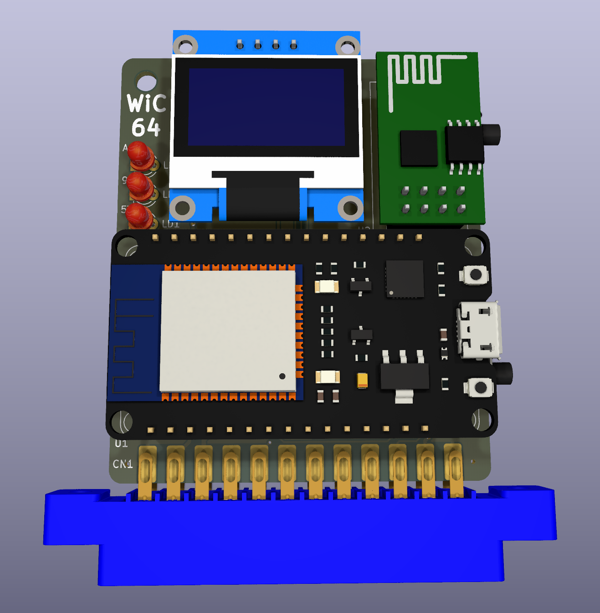

# WiC64-Plus4

WiC64-Plus4 is a WiFi network interface compatible with the Commodore 64, Commodore 16, 116 and Plus/4 computers.

## Summary
This is a slightly modified version of the [WiC64](https://github.com/WiC64-Team/wic64-hardware) board by GMP.

The only significant change is that the board can now be powered with either +5VDC or 9VAC.

This was done in order to make it easier to use the board on the Commodore 16 and Plus/4, where it must be connected through [an intermediate board](https://github.com/SukkoPera/PlusVIA) which only provides +5VDC.

Selection of the power source is automatic. If both power sources are available the higher one will take precedence. This means that **the board retains full compatibility with the C64**, and it will still use the 9VAC supply when connected to it.

Since the board might have a quite impulsive power draw, a ferrite bead was added on the +5VDC rail in order to reduce any interference.

## Usage and Programming
This version of the board is **100% compatible with the original** one.

Please refer to [the original project](https://github.com/WiC64-Team/wic64-hardware) for assembly instructions, BOM (note you will need an extra 1n5819 diode) and 3D-printable enclosures.

The board is supposed to be used with [the original firmware](https://github.com/WiC64-Team/wic64-firmware).

For software support, I have made [a modified version of the interface library](https://github.com/SukkoPera/wic64-library) that allows writing software for either the C64 or C16/Plus4, but the board also works with the original library when used on the C64.

## Releases
If you want to get this board produced, you are recommended to get [the latest release](https://github.com/SukkoPera/WiC64-Plus4/releases) rather than the current git version, as the latter might be under development and is not guaranteed to be working.

Every release is accompanied by its Bill Of Materials (BOM) file and any relevant notes about it, which you are recommended to read carefully.

## License
The WiC64-Plus4 documentation, including the design itself, is copyright &copy; 2021 GMP and SukkoPera 2024-2026 and is licensed under the [Creative Commons Attribution 4.0 International License](https://creativecommons.org/licenses/by/4.0/).

This documentation is distributed *as is* and WITHOUT ANY EXPRESS OR IMPLIED WARRANTIES whatsoever with respect to its functionality, operability or use, including, without limitation, any implied warranties OF MERCHANTABILITY, SATISFACTORY QUALITY, FITNESS FOR A PARTICULAR PURPOSE or infringement. We expressly disclaim any liability whatsoever for any direct, indirect, consequential, incidental or special damages, including, without limitation, lost revenues, lost profits, losses resulting from business interruption or loss of data, regardless of the form of action or legal theory under which the liability may be asserted, even if advised of the possibility or likelihood of such damages.

## Support the Project
If you want to get some boards manufactured, you can get them from PCBWay through this link:

You get my gratitude and cheap, professionally-made and good quality PCBs, I get some credit that will help with this and [other projects](https://www.pcbway.com/project/member/shareproject/?bmbid=41100). You won't even have to worry about the various PCB options, it's all pre-configured for you!

Also, if you still have to register, [you can use this link](https://www.pcbway.com/setinvite.aspx?inviteid=41100) to get some bonus initial credit (and earn me some more).

You can also buy me a coffee if you want.

## Thanks
* GMP and the WiC64 team for the original board, library and whole concept.
